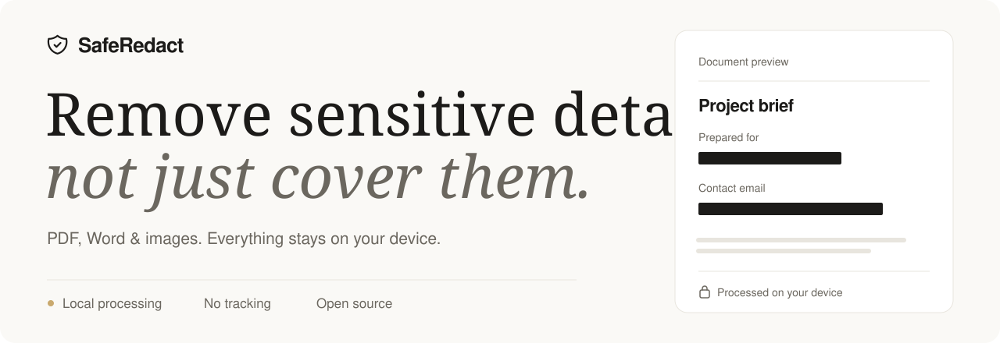

<picture>
  <source media="(prefers-color-scheme: dark)" srcset="docs/assets/readme-hero-dark.svg">
  <source media="(prefers-color-scheme: light)" srcset="docs/assets/readme-hero-light.svg">
  
</picture>

<h1 align="center">Safe Redact</h1>

<p align="center">
  Find and remove sensitive information from PDFs, Word documents, and images.<br>
  Your files stay on your device. No uploads, tracking, or telemetry.
</p>

<p align="center">
  <a href="https://github.com/zhendong/safe-redact/releases"><strong>Download for macOS</strong></a> ·
  <a href="#getting-started">Run locally</a> ·
  <a href="#how-it-works">How it works</a>
</p>

<p align="center">
  English · <a href="README.zh-CN.md">简体中文</a> · <a href="LICENSE">MIT license</a>
</p>

## Newly Added Features and Fixes

- **macOS app**: SafeRedact now runs as a native Mac app. OCR and the name-detection model are bundled, so it works fully offline, and the app is blocked from making any network connection. Open files from the File menu, the Dock, or Finder's "Open With", and save results with the native Save dialog. See [macOS App](#macos-app).
- **Image redaction**: Upload PNG, JPEG, or WebP images; Tesseract.js recognizes English and Simplified Chinese text for pattern matching. Review detections or draw a manual selection, then download a flattened PNG with the selected pixels covered.
- **OCR accuracy**: Image OCR is best effort. Tesseract.js can miss or misread text; inspect the entire image and manually select any sensitive area it missed before exporting.
- **Image metadata review**: Open Review Metadata for an uploaded image to inspect supported embedded EXIF, GPS, XMP, IPTC, and PNG tags. The downloaded PNG is redrawn from pixels, so original file metadata is not copied; inspect visible pixels separately.
- **Chinese language support**: Full UI translation with a one-click language toggle in the header, auto-detected from your browser locale and remembered across sessions
- **Image preview lightbox**: Preview images extracted from documents at full size right in the metadata review modal, with prev/next navigation, a thumbnail strip, and keyboard shortcuts (arrow keys, Escape)
- **More reliable entity review**: Fixed inconsistent selection status when confirming/rejecting detected entities, and removed the confusing pending/modified state

## How it works

1. **Open a file.** Choose a PDF, DOCX, PNG, JPEG, or WebP file, up to 50 MB.
2. **Review the details.** Check automatic detections, confirm what to remove, and draw selections over anything else. Review metadata and hidden content before exporting.
3. **Save a redacted copy.** Export the result locally. Enable document sanitization to remove supported metadata and hidden content as well.

## Features

| Feature | What you can do |
| :--- | :--- |
| **Find sensitive details** | Combine pattern matching, optional local machine learning, predefined words, and custom detection rules. |
| **Review with context** | Inspect detected entities beside the document, filter results, and confirm or reject them in bulk. |
| **Select manually** | Drag over sensitive areas that automatic detection missed. |
| **Look beyond visible text** | Review metadata and hidden content; inspect extracted document images in a full-size lightbox. |
| **Work your way** | Switch between English and Simplified Chinese, use light or dark mode, and work in your browser or the macOS app. |

### Supported formats

| Input | Review and redaction | Export |
| :--- | :--- | :--- |
| **PDF** | Text detection and manual selection in text-based PDFs | Redacted PDF; sanitization rebuilds pages as images with no selectable or searchable text layer. |
| **DOCX** | Sensitive text, document metadata, and hidden content | Redacted Word document, with optional sanitization. |
| **PNG · JPEG · WebP** | English and Simplified Chinese OCR, image metadata review, and manual selection | Flattened PNG with selected pixels covered; original file metadata is not copied. |

> Image OCR is best effort. Inspect the entire image and manually select anything sensitive that was missed before exporting. Images embedded in PDF and DOCX files are available for manual review; they are not automatically scanned with OCR.

## Privacy and offline use

Files are processed locally and never uploaded. Safe Redact includes no analytics or telemetry, and its source is open for inspection.

- **Browser:** OCR starts downloading its worker, engine, and language data when the page opens. Optional name detection also downloads a model. Let the required assets finish loading before disconnecting, and keep the tab open to continue working offline.
- **macOS app:** OCR and the name-detection model are bundled. The app works fully offline, and its Content Security Policy blocks outgoing network connections. External links open in your browser.

## Data Types Detected

Safe Redact detects the following types of sensitive information in PDF, DOCX, and OCR text from uploaded images:

<details>
<summary>View all detection types</summary>

### Personal Identifiers

- **Social Security Numbers (SSN)**: US Social Security Numbers in various formats
- **Email Addresses**: RFC 5322 compliant email addresses
- **Phone Numbers**:
  - US phone numbers (various formats)
  - International phone numbers
  - China mobile numbers (11-digit format)
  - China landline numbers

### Financial Information

- **Credit Card Numbers**:
  - Generic credit cards (13-19 digits with Luhn validation)
  - Visa cards (13 or 16 digits)
  - Mastercard (16 digits)
  - American Express (15 digits)
  - Discover cards
  - China UnionPay cards

### Dates

- MM/DD/YYYY format
- YYYY-MM-DD format
- Month DD, YYYY format
- Chinese date format (YYYY年MM月DD日)
- DD/MM/YYYY format (International)

### Additional Data Types (Custom)

- **Chinese National ID**: 18-digit ID with validation
- **Passports**:
  - Chinese Passport (current and legacy formats)
  - US Passport
- **Network Information**:
  - IPv4 addresses
  - IPv6 addresses
  - URLs (HTTP/HTTPS)
- **Cryptocurrency**: Bitcoin addresses
- **Custom Predefined Words**: User-defined sensitive terms

</details>

## Document Sanitization

When the "Sanitize Document" option is enabled, Safe Redact removes metadata and hidden content to prevent information leakage.

<details>
<summary>PDF metadata and hidden content</summary>

The following elements are removed from PDF documents:

**Metadata**:

- Title, Author, Subject, Keywords
- Creator, Producer
- Creation Date, Modification Date
- All other metadata fields

**Hidden Content**:

- Comments and annotations (all types)
- Markup annotations (highlights, underlines, strikeouts, etc.)
- Stamps and file attachments
- Multimedia content (sound, video)
- Form fields (optional)
- Embedded files
- JavaScript actions
- Optional Content Groups (PDF layers)

</details>

<details>
<summary>DOCX metadata and hidden content</summary>

The following elements are removed from DOCX documents:

**Metadata**:

- Core Properties: Title, Author, Subject, Keywords, Creator, Last Modified By, Dates, Category, Content Status
- App Properties: Application name, Version, Company, Manager, Template
- Custom Properties: All custom metadata

**Hidden Content**:

- Comments and comment references
- Track Changes/Revisions (insertions, deletions, moves, formatting changes)
- Bookmarks
- Custom XML data
- Document Settings: Revision identifiers (RSIDs), proof errors, document protection
- VBA/Macros and macro data
- (Optional) Headers and footers
- (Optional) Embedded objects and files

</details>

## Getting Started

### Prerequisites

- Node.js 20.19+ or 22.12+
- npm

### Installation

1. Clone the repository:

```bash
git clone https://github.com/zhendong/safe-redact.git
cd safe-redact
```

2. Install dependencies:

```bash
npm install
```

### Development

Start the development server:

```bash
npm run dev
```

The application will be available at `http://localhost:5173`

### Build

Build for production:

```bash
npm run build
```

The built files will be in the `dist/` directory.

### Testing

Run the test suite:

```bash
npm test
```

## macOS App

Download the DMG for your Mac (Apple Silicon or Intel) from [Releases](https://github.com/zhendong/safe-redact/releases) and drag SafeRedact to Applications. Requires macOS 13.4 or later.

The app is not notarized by Apple yet, so macOS blocks it the first time. Right-click SafeRedact in Applications and choose **Open**, then confirm. If macOS says the app is damaged, run:

```bash
xattr -cr /Applications/SafeRedact.app
```

What differs from the web version:

- **Fully offline**: OCR (Tesseract.js with English and Simplified Chinese) and the NER model are bundled in the app (about 145 MB download)
- **Faster name detection**: the NER model runs on native ONNX Runtime with multiple threads, several times faster than in a browser
- **No network access**: the app's Content Security Policy blocks all outgoing connections; links open in your browser
- **Native files**: open with ⌘O, the Dock, or Finder's "Open With"; save redacted files with ⌘S and the Save dialog

### Building the macOS App

Additional prerequisites: [Rust](https://rustup.rs) and Xcode Command Line Tools.

```bash
npm run tauri dev     # run the app with hot reload
npm run tauri build   # build SafeRedact.app and a DMG in src-tauri/target/release/bundle/
```

Both commands first run `npm run desktop:assets`, which copies the OCR files from `node_modules` and downloads the NER model from Hugging Face (about 180 MB, once) into `desktop-assets/`.

Pushing a `v*` tag runs the GitHub Actions workflow that builds Apple Silicon and Intel DMGs and attaches them to a draft release.

On an Intel Mac, or to build the Intel app, ONNX Runtime has no prebuilt binaries, so build it from source first (needs CMake; takes a while the first time):

```bash
scripts/build-onnxruntime-intel.sh
ORT_LIB_PATH=$PWD/src-tauri/onnxruntime/lib ORT_PREFER_DYNAMIC_LINK=1 \
  npm run tauri build -- --target x86_64-apple-darwin --config src-tauri/tauri.intel.conf.json
```

## Technology Stack

- **React 19 + TypeScript**: UI framework with type safety
- **Vite**: Fast build tool and dev server
- **MuPDF**: PDF parsing, rendering, and manipulation
- **PizZip + Mammoth**: DOCX processing
- **Transformers.js**: ML-based entity detection (optional)
- **Tesseract.js v5**: Image OCR; assets are loaded from a CDN in the browser and bundled on macOS
- **Tailwind CSS**: Utility-first styling

## Contributing

Contributions are welcome!

### Ways to Contribute

- Report bugs and issues
- Suggest new features
- Improve documentation
- Submit pull requests
- Add test cases

### Reporting Bugs

SafeRedact runs offline, so please attach a diagnostic log to bug reports: open **Settings → Diagnostics → Save Diagnostic Log**. The log records the app version, environment, settings, timings, and errors, but never document content, file names, or predefined words.

In the macOS app, logs are also kept in `~/Library/Logs/io.github.zhendong.saferedact/` (**Help → Show Log Files**). To include more detail, run `localStorage.setItem('safe-redact-verbose-logging', 'true')` in the browser console, reload, and reproduce the bug.

## License

MIT License - see [LICENSE](LICENSE) file for details
