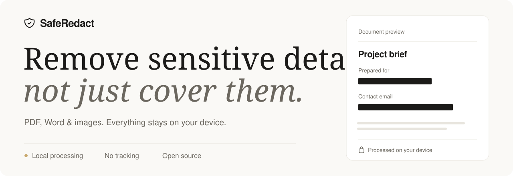

<picture>
  <source media="(prefers-color-scheme: dark)" srcset="docs/assets/readme-hero-dark.svg">
  <source media="(prefers-color-scheme: light)" srcset="docs/assets/readme-hero-light.svg">
  
</picture>

<h1 align="center">Safe Redact</h1>

<p align="center">
  找出并移除 PDF、Word 文档和图片中的敏感信息。<br>
  文件始终留在你的设备上，不上传，无追踪，无遥测。
</p>

<p align="center">
  <a href="https://github.com/zhendong/safe-redact/releases"><strong>下载 macOS 应用</strong></a> ·
  <a href="#快速开始">本地运行</a> ·
  <a href="#使用流程">使用流程</a>
</p>

<p align="center">
  <a href="README.md">English</a> · 简体中文 · <a href="LICENSE">MIT 许可证</a>
</p>

## 最新功能与修复

- **macOS 应用**：SafeRedact 现已提供原生 Mac 应用。OCR 和人名识别模型已内置，可完全离线使用，且应用被禁止发起任何网络连接。可通过“文件”菜单、程序坞或访达的“打开方式”打开文件，并用系统“存储”对话框保存结果。详见 [macOS 应用](#macos-应用)。
- **图片脱敏**：上传 PNG、JPEG 或 WebP 图片，使用 Tesseract.js 识别英文和简体中文文字并匹配敏感信息。可审核识别结果或手动框选，最后下载像素已遮盖的 PNG 图片。
- **识别准确性**：图片 OCR 仅供辅助，Tesseract.js 可能漏识或误识文字。导出前请检查整张图片，并手动框选遗漏的敏感区域。
- **图片元数据审阅**：上传后可打开“审阅元数据”，查看受支持的 EXIF、GPS、XMP、IPTC 和 PNG 嵌入标签。下载的 PNG 由像素重新绘制，不会复制原文件元数据；仍需单独检查可见内容。
- **中文语言支持**：完整的中文界面翻译，可在页眉一键切换语言，自动检测浏览器语言并记住你的选择
- **图片预览灯箱**：可在元数据审阅弹窗中直接全尺寸预览文档中提取的图片，支持上一张/下一张导航、缩略图列表以及键盘快捷键（方向键、Esc）
- **更可靠的实体审阅**：修复了确认/拒绝检测实体时状态不一致的问题，并移除了容易引起困惑的「待定/已修改」状态

## 使用流程

1. **打开文件。** 选择 PDF、DOCX、PNG、JPEG 或 WebP 文件，大小不超过 50 MB。
2. **审阅敏感信息。** 检查自动检测结果，确认需要移除的内容，并手动框选其他敏感区域。导出前审阅元数据和隐藏内容。
3. **保存脱敏副本。** 在本地导出结果。启用文档净化，还可移除受支持的元数据和隐藏内容。

## 功能特性

| 功能 | 你可以做什么 |
| :--- | :--- |
| **查找敏感信息** | 结合模式匹配、可选的本地机器学习、预设词汇和自定义检测规则。 |
| **对照原文审阅** | 在文档旁查看检测结果，筛选实体，批量确认或拒绝。 |
| **手动框选** | 拖动选择自动检测遗漏的敏感区域。 |
| **检查隐藏信息** | 审阅元数据和隐藏内容，通过全尺寸灯箱预览文档中提取的图片。 |
| **按你的习惯使用** | 切换中英文界面与浅色、深色模式，在浏览器或 macOS 应用中处理文件。 |

### 支持的格式

| 输入 | 审阅与脱敏 | 导出 |
| :--- | :--- | :--- |
| **PDF** | 对基于文本的 PDF 进行文字检测和手动框选 | 脱敏 PDF；启用净化后，页面由图片重新生成，不含可选中或搜索的文字层。 |
| **DOCX** | 敏感文字、文档元数据和隐藏内容 | 脱敏 Word 文档，可选择同时净化。 |
| **PNG · JPEG · WebP** | 英文和简体中文 OCR、图片元数据审阅与手动框选 | 选定像素已遮盖的扁平化 PNG，不复制原文件元数据。 |

> 图片 OCR 仅供辅助。导出前请检查整张图片，并手动框选遗漏的敏感内容。PDF 和 DOCX 中嵌入的图片可供手动审阅，不会自动进行 OCR 识别。

## 隐私与离线使用

文件全程在本机处理，不会上传。Safe Redact 不含任何分析或遥测服务，源代码开放，可供检查。

- **浏览器：** 页面打开后会开始下载 OCR 的工作线程、引擎和语言数据；可选的人名检测还需下载模型。请等待所需资源加载完成后再断网，并保持标签页打开，以继续离线使用。
- **macOS 应用：** OCR 和人名识别模型均已内置，可完全离线使用。应用的内容安全策略（CSP）阻止对外网络连接，外部链接会在浏览器中打开。

## 可检测的数据类型

Safe Redact 可自动检测 PDF、DOCX 以及上传图片识别出的文字中以下类型的敏感信息：

<details>
<summary>查看完整检测类型</summary>

### 个人身份信息

- **社会安全号码（SSN）**：多种格式的美国社会安全号码
- **电子邮件地址**：符合 RFC 5322 标准的电子邮件地址
- **电话号码**：
  - 美国电话号码（多种格式）
  - 国际电话号码
  - 中国手机号码（11 位格式）
  - 中国座机号码

### 财务信息

- **信用卡号**：
  - 通用信用卡（13-19 位，含 Luhn 校验）
  - Visa 卡（13 或 16 位）
  - Mastercard（16 位）
  - American Express（15 位）
  - Discover 卡
  - 中国银联卡

### 日期

- MM/DD/YYYY 格式
- YYYY-MM-DD 格式
- Month DD, YYYY 格式
- 中文日期格式（YYYY年MM月DD日）
- DD/MM/YYYY 格式（国际）

### 其他数据类型（自定义）

- **中国居民身份证号**：18 位身份证号，含校验
- **护照**：
  - 中国护照（现行版和旧版格式）
  - 美国护照
- **网络信息**：
  - IPv4 地址
  - IPv6 地址
  - URL（HTTP/HTTPS）
- **加密货币**：比特币地址
- **自定义预设词汇**：用户自定义的敏感词条

</details>

## 文档净化

启用「净化文档（Sanitize Document）」选项后，Safe Redact 会移除元数据和隐藏内容，防止信息泄露。

<details>
<summary>PDF 元数据与隐藏内容</summary>

以下内容将从 PDF 文档中移除：

**元数据**：

- 标题、作者、主题、关键词
- 创建者、生成程序
- 创建日期、修改日期
- 其他所有元数据字段

**隐藏内容**：

- 批注和注释（所有类型）
- 标记类注释（高亮、下划线、删除线等）
- 图章和文件附件
- 多媒体内容（声音、视频）
- 表单字段（可选）
- 嵌入文件
- JavaScript 脚本
- 可选内容组（PDF 图层）

</details>

<details>
<summary>DOCX 元数据与隐藏内容</summary>

以下内容将从 DOCX 文档中移除：

**元数据**：

- 核心属性：标题、作者、主题、关键词、创建者、最后修改者、日期、类别、内容状态
- 应用属性：应用程序名称、版本、公司、管理者、模板
- 自定义属性：所有自定义元数据

**隐藏内容**：

- 批注及批注引用
- 修订记录/修订痕迹（插入、删除、移动、格式更改）
- 书签
- 自定义 XML 数据
- 文档设置：修订标识符（RSID）、拼写检查错误、文档保护
- VBA/宏及宏数据
- （可选）页眉和页脚
- （可选）嵌入对象和文件

</details>

## 快速开始

### 前置条件

- Node.js 20.19+ 或 22.12+
- npm

### 安装

1. 克隆仓库：

```bash
git clone https://github.com/zhendong/safe-redact.git
cd safe-redact
```

2. 安装依赖：

```bash
npm install
```

### 开发

启动开发服务器：

```bash
npm run dev
```

应用将运行在 `http://localhost:5173`

### 构建

生产环境构建：

```bash
npm run build
```

构建产物位于 `dist/` 目录。

### 测试

运行测试套件：

```bash
npm test
```

## macOS 应用

从 [Releases](https://github.com/zhendong/safe-redact/releases) 下载适合你 Mac 的 DMG（Apple 芯片或 Intel），将 SafeRedact 拖入“应用程序”文件夹。需要 macOS 13.4 或更高版本。

应用尚未经过 Apple 公证，首次打开会被 macOS 拦截。请在“应用程序”中右键点击 SafeRedact，选择**打开**并确认。如果提示应用已损坏，请运行：

```bash
xattr -cr /Applications/SafeRedact.app
```

与网页版的区别：

- **完全离线**：OCR（Tesseract.js，支持英文和简体中文）和 NER 模型已内置（下载约 145 MB）
- **更快的人名识别**：NER 模型通过原生 ONNX Runtime 多线程运行，速度比浏览器快数倍
- **禁止联网**：应用的内容安全策略（CSP）阻止所有对外连接，链接会在浏览器中打开
- **原生文件操作**：通过 ⌘O、程序坞或访达的“打开方式”打开文件；用 ⌘S 和“存储”对话框保存脱敏文件

### 构建 macOS 应用

额外前置条件：[Rust](https://rustup.rs) 和 Xcode 命令行工具。

```bash
npm run tauri dev     # 以热重载方式运行应用
npm run tauri build   # 在 src-tauri/target/release/bundle/ 生成 SafeRedact.app 和 DMG
```

两条命令都会先运行 `npm run desktop:assets`：从 `node_modules` 复制 OCR 文件，并从 Hugging Face 下载 NER 模型（约 180 MB，仅首次）到 `desktop-assets/`。

推送 `v*` 标签会触发 GitHub Actions 工作流，构建 Apple 芯片和 Intel 版 DMG 并附加到草稿版本中。

在 Intel Mac 上（或构建 Intel 版应用时），ONNX Runtime 没有预编译库，需先从源码构建（需要 CMake，首次耗时较长）：

```bash
scripts/build-onnxruntime-intel.sh
ORT_LIB_PATH=$PWD/src-tauri/onnxruntime/lib ORT_PREFER_DYNAMIC_LINK=1 \
  npm run tauri build -- --target x86_64-apple-darwin --config src-tauri/tauri.intel.conf.json
```

## 技术栈

- **React 19 + TypeScript**：具备类型安全的 UI 框架
- **Vite**：快速的构建工具和开发服务器
- **MuPDF**：PDF 解析、渲染与操作
- **PizZip + Mammoth**：DOCX 处理
- **Transformers.js**：基于机器学习的实体检测（可选）
- **Tesseract.js v5**：用于图片文字识别；浏览器版通过 CDN 加载资源，macOS 版已内置
- **Tailwind CSS**：原子化 CSS 样式方案

## 参与贡献

欢迎贡献！

### 贡献方式

- 报告 Bug 和问题
- 提出新功能建议
- 改进文档
- 提交 Pull Request
- 添加测试用例

### 报告 Bug

SafeRedact 离线运行，提交问题时请附上诊断日志：打开 **设置 → 诊断 → 保存诊断日志**。日志记录应用版本、运行环境、设置、耗时和错误信息，但绝不包含文档内容、文件名或预定义词汇。

在 macOS 应用中，日志也保存在 `~/Library/Logs/io.github.zhendong.saferedact/`（**帮助 → 显示日志文件**）。如需更详细的日志，请在浏览器控制台运行 `localStorage.setItem('safe-redact-verbose-logging', 'true')`，刷新页面后重现问题。

## 许可证

MIT License - 详见 [LICENSE](LICENSE) 文件
